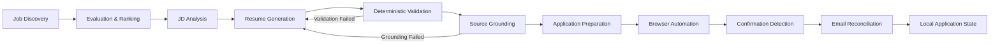

# JobAgent

### Local-First AI-Assisted Job Application Automation

JobAgent is a personal automation platform I built to reduce the repetitive work involved in searching for jobs, evaluating roles, tailoring resumes, preparing applications, and tracking application outcomes.

The project runs locally because it works with sensitive information such as resumes, application data, browser sessions, email confirmations, and candidate profile information.

> **Note:** This repository is intentionally documentation-only.  
> The production source code, credentials, personal data, application records, resumes, logs, and private configuration are not published.

---

## What JobAgent Does

JobAgent combines AI-assisted generation with deterministic validation and browser automation to support an end-to-end job application workflow.

The system can:

- Evaluate and rank job opportunities
- Analyze job descriptions and technical responsibilities
- Generate role-specific resume content
- Validate generated resume bullets before they are accepted
- Map resume bullets back to specific job responsibilities
- Prepare application packages
- Automate browser-based application workflows
- Answer known application questions from configured profile data
- Detect uncertain application states before attempting duplicate submissions
- Reconcile application confirmations and rejections through email
- Maintain local application state, retries, cooldowns, and logs

---

## Architecture

---

## Resume Tailoring Engine

One of the main parts of JobAgent is the resume generation pipeline.

Instead of accepting LLM output directly, the system combines model-generated content with Python-owned rules and validation.

Depending on the number and structure of technical responsibilities in a job description, the system creates an adaptive **6, 7, or 8 bullet responsibility coverage plan**.

Each generated bullet is mapped to one or more job responsibilities.

The pipeline checks:

- Responsibility coverage
- Source grounding
- Duplicate wording
- Unsupported claims
- Technology references
- Target-employer leakage
- Bullet length
- Formatting constraints

Resume bullets are restricted to a maximum of:

**125 characters / 22 words**

This helps keep the final resume layout predictable while still requiring technical responsibility coverage.

---

## Source Grounding

Generated resume content is not treated as correct simply because an LLM produced it.

JobAgent checks whether each bullet actually contains enough evidence to support the responsibility assigned to it.

If grounding fails, the system can regenerate the response using structured feedback rather than silently accepting weak or unrelated wording.

This became one of the more difficult parts of the project because overly aggressive automated repairs could technically satisfy keyword checks while still producing poor resume language.

The final design separates responsibilities between the LLM and deterministic Python logic.

### LLM Responsibilities

- Write natural resume language
- Combine related technical concepts
- Adapt wording to the target role
- Produce structured candidate content

### Python Responsibilities

- Responsibility assignment
- Deterministic validation
- Source grounding
- Length enforcement
- Duplicate detection
- Safety checks
- Application-state control

---

## Adaptive Responsibility Coverage

Not every job description contains the same number of technical responsibilities.

JobAgent dynamically builds a responsibility coverage plan using **6, 7, or 8 resume bullets**.

When multiple responsibilities must share a bullet, the system verifies that the final sentence genuinely supports every assigned responsibility.

This prevents metadata from claiming that a bullet covers responsibilities that are not actually represented in the bullet text.

The system also attempts to group technically related responsibilities instead of combining them arbitrarily.

---

## Deterministic Resume Validation

Before generated resume content can be accepted, JobAgent runs deterministic validation.

Validation includes checks for:

- Missing technical responsibilities
- Unsupported technical claims
- Excessive bullet length
- Excessive word count
- Duplicate content
- Missing required technologies
- Responsibility-to-bullet mismatches
- Target-company references inside prior work experience
- Formatting problems that may affect PDF rendering

If validation fails, the model receives structured feedback and another generation attempt can be performed.

---

## One-Line Resume Constraints

The project enforces strict bullet limits to preserve predictable resume formatting.

Each resume bullet must remain within:

- **125 characters maximum**
- **22 words maximum**

The system includes deterministic repair logic for some formatting problems, but repairs are only accepted when the resulting bullet still satisfies its assigned responsibilities.

If a safe repair cannot be produced, the bullet is sent back for regeneration instead of being silently shortened into something misleading.

---

## Browser Automation

JobAgent uses **Playwright** for browser-based application workflows.

The browser layer handles areas such as:

- Application page navigation
- Posting availability checks
- Form-field discovery
- Text inputs
- Dropdowns
- Multi-select controls
- Profile-based application questions
- Resume uploads
- Application review states
- Submission-state verification

The system is designed to stop when an answer or application state cannot be determined safely.

---

## Profile-Driven Application Questions

Some application questions can be answered deterministically using configured candidate profile information.

Rather than asking an LLM to guess personal information, known profile questions are mapped to explicitly configured values.

This approach is used for areas such as:

- Work authorization
- Location
- Years of experience
- Previous applications
- Employer-specific questions
- Language proficiency
- Employment-history questions
- Other known candidate-profile fields

Questions without reliable configured answers can be blocked for review instead of being answered speculatively.

---

## Application Safety

Automating job applications creates a major risk: accidentally submitting the same application more than once.

JobAgent includes application-state safeguards that distinguish between:

- Confirmed submissions
- Failed submissions
- Incomplete submissions
- Uncertain confirmation states

When a submission result cannot be verified confidently, the system can preserve a **confirmation-uncertain** state instead of assuming the application failed.

This prevents uncertain browser states from automatically triggering duplicate submissions.

---

## Email Reconciliation

JobAgent can use Gmail synchronization to identify application-related messages such as:

- Application confirmations
- Rejection emails
- Recruiter responses
- Application-status messages

Those messages can then be reconciled with local application records.

This provides another source of truth beyond what occurred during the browser session.

---

## Retry and Cooldown Handling

The project includes retry and cooldown behavior for failures that should not immediately trigger another attempt.

Examples include:

- LLM generation failures
- Resume validation failures
- Browser workflow problems
- Posting availability uncertainty
- Authentication failures
- Application confirmation uncertainty
- Temporary service failures

This helps prevent repeated failures from turning into uncontrolled retry loops.

---

## Local Application State

JobAgent maintains local state for the application workflow.

This allows the system to track information such as:

- Evaluated jobs
- Ranked jobs
- Prepared applications
- Resume-generation status
- Submission attempts
- Confirmation state
- Rejection state
- Retry state
- Cooldowns
- Application history

The project was designed around maintaining workflow state rather than treating each application attempt as an isolated script execution.

---

## Local-First Design

The project intentionally runs locally.

Job application automation involves information that should not be placed in a public repository, including:

- Candidate profile information
- Resumes
- Addresses
- Email data
- OAuth credentials
- Browser-session information
- Job application history
- Generated application packages
- Internal logs
- Private configuration
- Authentication tokens

For that reason, the working JobAgent implementation remains private.

This public repository exists only to document the architecture, engineering decisions, and technologies used to build the system.

---

## Tech Stack

### Core Development

- Python
- PowerShell
- Git

### AI / LLM

- Ollama
- Qwen
- Structured LLM generation
- Deterministic grounding
- Rule-based validation

### Browser Automation

- Playwright

### Integrations

- Gmail API
- OAuth

### Configuration and Data

- YAML
- JSON
- Local application state
- Structured logging

### Automation Concepts

- Retry handling
- Cooldown management
- State reconciliation
- Duplicate prevention
- Deterministic validation
- Safety gates
- Workflow orchestration

---

## Engineering Challenges

Some of the most difficult parts of the project were not the individual integrations, but getting all of them to behave reliably together.

Examples included:

- Preventing hallucinated resume claims
- Keeping generated bullets within strict formatting limits
- Mapping multiple technical responsibilities into concise resume bullets
- Maintaining natural language while enforcing deterministic grounding
- Distinguishing portable technologies from employer-specific systems
- Handling dynamically rendered application controls
- Answering application questions without guessing
- Detecting whether an application was actually submitted
- Preventing duplicate submissions after uncertain confirmations
- Reconciling browser state with email confirmations
- Recovering from authentication failures
- Managing retry and cooldown behavior
- Preserving application state across failures
- Handling changing application forms across different ATS platforms

Most of the development effort went into reliability, validation, state management, and edge cases rather than the basic happy path.

---

## Key Design Principle

A major design principle behind JobAgent is:

> **Use AI for generation, but use deterministic systems for control.**

The LLM can generate and adapt language, but Python controls whether that output is structurally valid, grounded, safe, and acceptable for the next stage of the workflow.

The same principle applies to application automation: uncertain states should stop or require reconciliation rather than being automatically treated as success or failure.

---

## Repository Status

**Public portfolio documentation**

The production implementation remains private and local.

This repository documents the system design, engineering challenges, architecture, and technologies used to build JobAgent without publishing sensitive source code or personal application data.
