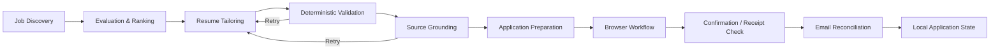

# JobAgent

**Local-first AI-assisted job application workflow automation**

JobAgent is a private, local-first automation project I built to reduce repetitive work across job discovery, resume tailoring, application preparation, browser workflows, and application-status tracking.

> **Public portfolio note:** This repository is intentionally a showcase only. The production source code, personal application data, resumes, credentials, tokens, configuration secrets, and private workflow records are not published.

## What it does

- Evaluates and ranks job opportunities using structured criteria.
- Generates role-specific resume content with an adaptive 6–8 bullet strategy.
- Maps resume bullets to job responsibilities and validates that the wording is grounded in the source job description.
- Enforces resume formatting constraints, including one-line bullet limits of **125 characters / 22 words**.
- Uses Playwright-based browser workflows for application preparation, form handling, and submission-state checks.
- Supports profile-driven answers for known application questions while blocking uncertain or unsupported responses.
- Reconciles application confirmations and rejections through email synchronization.
- Maintains local application state, retry/cooldown logic, duplicate-prevention safeguards, and structured logs.

## Architecture

## Engineering highlights

### AI-assisted resume generation
The resume pipeline combines local LLM generation with deterministic Python validation rather than trusting generated output directly. Responsibility coverage, bullet count, formatting, and source grounding are checked before a resume is accepted.

### Adaptive responsibility coverage
The system supports **6, 7, or 8** resume bullets depending on the number and structure of technical responsibilities in the job description. Multiple responsibilities can be mapped to one bullet only when the final wording still supports each assigned responsibility.

### Grounding and validation
Generated claims are checked against the source job description. The system includes responsibility-to-bullet grounding, portable technology validation, target-employer leakage protection, duplicate checks, formatting checks, strict bullet-length validation, and retry feedback for failed generations.

### Browser automation
Playwright workflows handle application-page interaction, field discovery, known profile questions, selection controls, posting-liveness checks, and confirmation-state handling.

### Application-state reconciliation
The project tracks local application state and uses email synchronization to reconcile confirmation and rejection messages while preserving duplicate-protection safeguards.

## Tech stack

- **Python**
- **Playwright**
- **Ollama / local LLMs**
- **Qwen**
- **YAML / JSON**
- **Gmail API / OAuth**
- **Git**
- **PowerShell**
- Structured validation and rule-based grounding

## Privacy and security

JobAgent was designed around local execution because the workflow contains sensitive personal information.

The public repository does **not** include:

- production source code
- API keys or OAuth tokens
- email credentials
- resumes or application documents
- personal addresses or profile data
- real application records
- logs containing job-application history
- private configuration
- local backups

## Why the full source is private

The project directly handles personal application data, authentication tokens, resume content, browser sessions, and local workflow state. Publishing the working repository would expose implementation details and data that should remain private.

This repository therefore documents the engineering approach and system design without publishing sensitive implementation material.

## Status

Portfolio showcase / private production project.

The production implementation remains local and private.
